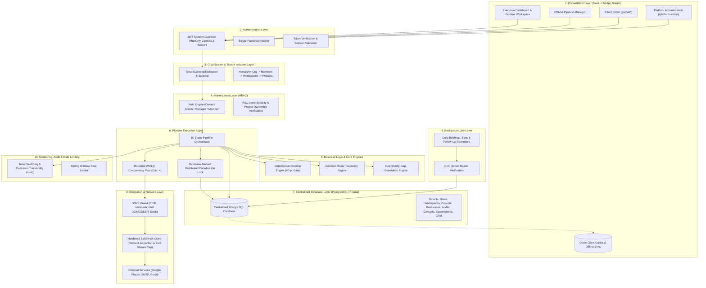

# WATECH-BI — TARGET SAAS ARCHITECTURE SPECIFICATION
**Prompt 06: Phase 2 — Target Architecture Design**  
**Date:** November 9, 2026  
**Architect:** Principal SaaS Architect & Distributed Systems Engineer  
**Project:** `E:\watech-bi`

---

## 1. TARGET ARCHITECTURAL BLUEPRINT

The target architecture transitions Watech-BI from a browser-isolated local tool into a unified, secure, enterprise-grade multi-tenant SaaS platform. Every data record belongs strictly to an Organization (Tenant), is accessed through an authenticated and authorized server layer, and is backed by a centralized relational database.



---

## 2. THE 10 TARGET ARCHITECTURE LAYERS

### Layer 1: Presentation Layer
- **Components:** Next.js 14 App Router React Server & Client Components.
- **Client Cache Strategy:** Dexie IndexedDB acts strictly as a high-speed read cache and offline mirror. It never creates authoritative records that bypass server validation.
- **State Management:** SWR/React Query hooks synchronizing with server REST API endpoints.

### Layer 2: Authentication Layer
- **Tokens:** Stateless JSON Web Tokens (JWT) signed with HMAC-SHA256 using `JWT_SECRET`.
- **Delivery:** HttpOnly, SameSite=Lax, Secure cookies (`watech_auth_token`) for browser navigation; `Authorization: Bearer <token>` for programmatic API consumers.
- **Payload Contract:**
  ```json
  {
    "userId": "usr_abc123",
    "email": "user@agency.com",
    "fullName": "Jane Doe",
    "tenantId": "org_xyz789",
    "role": "admin",
    "isPlatformSuperAdmin": false,
    "iat": 1794184000,
    "exp": 1794788800
  }
  ```

### Layer 3: Organization & Tenant Layer
- **Hierarchy:**
  ```
  Organization (Tenant)
  └── Organization Members (Users with Roles)
      └── Workspaces
          └── Projects
              ├── Discovered Businesses
              │   ├── Technical Audits & Findings
              │   ├── Extracted Contacts & Decision Makers
              │   └── Opportunities & Lead Scores
              ├── CRM Activities
              └── Follow-Up Schedules
  ```
- **Tenant Context Enforcement:** Every server request resolves the tenant identity from the verified session claims. No client-supplied `organizationId` parameter is ever trusted.

### Layer 4: Authorization Layer (RBAC & Multi-Tenant Boundaries)
- **Roles:**
  - `owner` — Full organization control, billing, invitations, settings, all projects.
  - `admin` — Team management, project management, pipeline execution, CRM.
  - `manager` — Project and pipeline execution, CRM editing, proposal creation.
  - `member` (employee) — Read access to assigned projects, view leads, log CRM activities.
- **Ownership Verification:** Before reading or mutating any project, business, audit, or CRM record, the server verifies `record.tenantId === session.tenantId`. Violations immediately return HTTP 403 Forbidden.

### Layer 5: Business Logic Layer
- **Deterministic Lead Scoring:** 100-point composite algorithm evaluating website defects, local presence, responsiveness, and decision-maker availability.
- **Decision Maker Taxonomy:** Strict classification separating verified executive leadership (CEO, Owner, Founder, VP) from non-decision-maker staff.
- **Opportunity Generator:** Converts concrete audit defects into pitch opportunities.

### Layer 6: Pipeline Execution Layer
- **Unified 10-Stage Pipeline:** Single-click execution coordinating discovery through CRM scheduling.
- **Bounded Worker Concurrency:** Strict concurrency pool (cap: 4 concurrent outbound workers) prevents socket exhaustion and CPU spikes.
- **Distributed Coordination Lock:** Replaces in-process mutexes with database-backed lock records (`PipelineLock`) keyed by `${tenantId}:${projectId}` with automatic TTL expiration.

### Layer 7: Centralized Database Layer
- **Authoritative Store:** PostgreSQL accessed via Prisma ORM.
- **Data Integrity:** Foreign key constraints with `onDelete: Cascade` guaranteeing zero orphaned records.
- **Transactions:** Multi-table ACID transactions guaranteeing that lead scores, opportunities, audits, and contacts are saved atomically.

### Layer 8: Integration & Network Security Layer
- **SSRF Guard:** Absolute defense preventing external crawler requests to private IPs (`10.0.0.0/8`, `192.168.0.0/16`, `127.0.0.1`, `::1`), cloud metadata (`169.254.169.254`), and sensitive service ports (`22`, `25`, `5432`, `6379`, `3000`).
- **Hardened HTTP Client (`safeFetch`):** Capped at 2MB download, enforces max 3 redirects, re-verifies redirect targets against SSRF rules.

### Layer 9: Background Job Layer
- **Scheduled Sync & Reminders:** Vercel Cron routes (`/api/cron/reminders`, `/api/cron/briefing`, `/api/cron/sync`) protected by `CRON_SECRET` authorization bearer headers.

### Layer 10: Monitoring, Audit & Rate Limiting
- **Audit Logging:** Every critical administrative mutation, export, or pipeline run writes to `TenantAuditLog`.
- **Traceability:** Every execution assigns a unique `runId` recorded across all stage logs.

---

## 3. SUMMARY OF ARCHITECTURAL ADVANTAGES

1. **Elimination of Data Trapping:** Data created by one user is immediately visible to authorized teammates in the organization.
2. **Ironclad Multi-Tenant Boundaries:** Cryptographically signed tokens guarantee no cross-organization data leakage.
3. **Multi-Instance Global Concurrency:** Database-backed locks ensure two users or background workers on separate serverless lambdas cannot corrupt the same project concurrently.
4. **Resilient Local Caching:** Dexie remains as a fast offline read cache without compromising the central database as source of truth.
