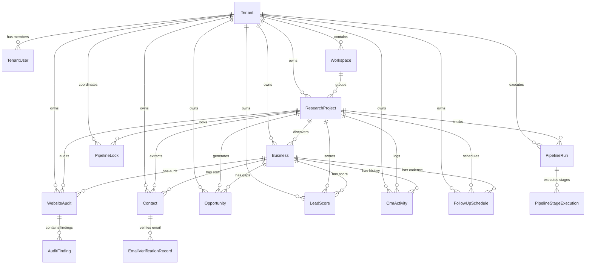

# WATECH-BI — CENTRALIZED DATABASE SCHEMA SPECIFICATION
**Prompt 06: Phase 3 — Centralized Database Architecture**  
**Date:** November 9, 2026  
**Architect:** Enterprise Database Architect & Security Specialist  
**Database Engine:** PostgreSQL 15+ / Prisma ORM 5.22.0  
**Schema File:** `prisma/schema.prisma`

---

## 1. ENTITY RELATIONSHIP MODEL (ERD)

---

## 2. CENTRALIZED DATA ENTITIES & SCHEMAS

### 2.1 Core Multi-Tenancy & Access Control
1. **`tenants`:**
   - `id` (UUID PK): Global organization identifier.
   - `slug` (VARCHAR UNIQUE): Subdomain / slug identifier.
   - `name` (VARCHAR): Organization display name.
   - `planId` (VARCHAR): Current subscription license tier.
   - `status` (VARCHAR): `active`, `suspended`, `trial`.
   - `contactEmail` (VARCHAR): Billing and administrative owner email.
   - `isPlatformSuperAdminTenant` (BOOLEAN): Platform operator flag.
2. **`tenant_users`:**
   - `id` (UUID PK): User identifier.
   - `tenantId` (UUID FK -> `tenants.id` ON DELETE CASCADE): Organization boundary.
   - `email` (VARCHAR): User email (UNIQUE per tenant).
   - `passwordHash` (VARCHAR): Bcrypt salted password hash.
   - `fullName` (VARCHAR): User display name.
   - `role` (VARCHAR): `owner`, `admin`, `manager`, `employee`.
   - `status` (VARCHAR): `active`, `deactivated`.
3. **`tenant_sessions`:**
   - `id` (UUID PK)
   - `sessionToken` (VARCHAR UNIQUE)
   - `tenantId` (UUID FK), `userId` (UUID FK)
   - `expiresAt` (TIMESTAMPTZ)
4. **`workspaces`:**
   - `id` (UUID PK)
   - `tenantId` (UUID FK -> `tenants.id` ON DELETE CASCADE)
   - `name` (VARCHAR), `slug` (VARCHAR)
   - `isDefault` (BOOLEAN)

---

### 2.2 Operational Pipeline & Lead Intelligence
5. **`projects` (`ResearchProject`):**
   - `id` (UUID PK): Project identifier.
   - `tenantId` (UUID FK -> `tenants.id` ON DELETE CASCADE)
   - `workspaceId` (UUID FK -> `workspaces.id` ON DELETE SET NULL)
   - `name` (VARCHAR): Project title.
   - `industryNiche` (VARCHAR): e.g. "HVAC", "Roofing".
   - `cityArea` (VARCHAR): e.g. "Canton, Ohio, USA".
   - `status` (VARCHAR): `active`, `archived`.
6. **`businesses`:**
   - `id` (VARCHAR PK): Business identifier (`biz-...` or UUID).
   - `tenantId` (UUID FK -> `tenants.id` ON DELETE CASCADE)
   - `projectId` (UUID FK -> `projects.id` ON DELETE CASCADE)
   - `officialName` (VARCHAR): Legal business name.
   - `brandName` (VARCHAR): DBA / trade name.
   - `domain` (VARCHAR): Domain name.
   - `websiteUrl` (VARCHAR): Validated website URL.
   - `phone` (VARCHAR): Formatted telephone.
   - `status` (VARCHAR): `discovered`, `audited`, `qualified`, `contacted`.
   - `opportunityScore` (INT): Composite lead score (0–100).
7. **`website_audits`:**
   - `id` (VARCHAR PK): Audit identifier (`aud-...`).
   - `tenantId` (UUID FK -> `tenants.id` ON DELETE CASCADE)
   - `businessId` (VARCHAR FK -> `businesses.id` ON DELETE CASCADE)
   - `projectId` (UUID FK -> `projects.id` ON DELETE CASCADE)
   - `targetUrl` (VARCHAR): Audited website address.
   - `totalScore` (INT): Aggregate audit score.
   - `grade` (VARCHAR): Letter grade (A, B, C, D, F).
   - `dimensions` (JSONB): Scores across Performance, SEO, Conversion, UX.
   - `categories` (JSONB): Technical categories breakdown.
8. **`audit_findings`:**
   - `id` (VARCHAR PK): Finding identifier (`fnd-...`).
   - `tenantId` (UUID FK -> `tenants.id` ON DELETE CASCADE)
   - `auditId` (VARCHAR FK -> `website_audits.id` ON DELETE CASCADE)
   - `category` (VARCHAR): e.g. `mobile_responsiveness`, `ttfb_latency`.
   - `severity` (VARCHAR): `high`, `medium`, `low`.
   - `observation` (TEXT): Concrete technical defect.
   - `evidenceUrlOrSnippet` (TEXT): Extracted proof snippet.
9. **`contacts`:**
   - `id` (VARCHAR PK): Contact identifier (`cnt-...`).
   - `tenantId` (UUID FK -> `tenants.id` ON DELETE CASCADE)
   - `businessId` (VARCHAR FK -> `businesses.id` ON DELETE CASCADE)
   - `projectId` (UUID FK -> `projects.id` ON DELETE CASCADE)
   - `fullName` (VARCHAR): Person's name.
   - `roleOrTitle` (VARCHAR): Job title.
   - `isDecisionMaker` (BOOLEAN): Flag for verified leadership.
   - `decisionMakerTier` (VARCHAR): `tier1_executive`, `tier2_director`, `tier3_management`, `general_staff`.
   - `email` (VARCHAR): Contact email.
   - `emailVerificationStatus` (VARCHAR): `verified`, `unverified`, `failed`.
10. **`email_verification_records`:**
    - `id` (VARCHAR PK)
    - `tenantId` (UUID FK -> `tenants.id` ON DELETE CASCADE)
    - `contactId` (VARCHAR FK -> `contacts.id` ON DELETE SET NULL)
    - `email` (VARCHAR), `domain` (VARCHAR)
    - `hasMxRecords` (BOOLEAN): DNS MX availability flag.
    - `mxHosts` (JSONB): Discovered mail exchanger hosts.
11. **`opportunities`:**
    - `id` (VARCHAR PK): Opportunity identifier (`opp-...`).
    - `tenantId` (UUID FK -> `tenants.id` ON DELETE CASCADE)
    - `businessId` (VARCHAR FK -> `businesses.id` ON DELETE CASCADE)
    - `projectId` (UUID FK -> `projects.id` ON DELETE CASCADE)
    - `category` (VARCHAR): e.g. `website_speed`, `local_seo`.
    - `title` (VARCHAR): Short proposal gap summary.
    - `description` (TEXT): Detailed pitch narrative.
    - `severity` (VARCHAR), `impact` (VARCHAR)
    - `confidenceScore` (INT): Algorithmic confidence (0–100).
    - `evidenceSnippets` (JSONB): Reference to audit defect IDs.
12. **`lead_scores`:**
    - `id` (VARCHAR PK): Score identifier (`score-...`).
    - `tenantId` (UUID FK -> `tenants.id` ON DELETE CASCADE)
    - `businessId` (VARCHAR FK -> `businesses.id` ON DELETE CASCADE)
    - `projectId` (UUID FK -> `projects.id` ON DELETE CASCADE)
    - `score` (INT): Calculated 0–100 lead score.
    - `scoreBand` (VARCHAR): `A`, `B`, `C`, `Hold`.
    - `isQualified` (BOOLEAN): True if score >= 40.
    - `scoringBreakdown` (JSONB): Complete 14-dimension breakdown.
13. **`crm_activities`:**
    - `id` (VARCHAR PK): Activity identifier (`crm-...`).
    - `tenantId` (UUID FK -> `tenants.id` ON DELETE CASCADE)
    - `businessId` (VARCHAR FK -> `businesses.id` ON DELETE CASCADE)
    - `projectId` (UUID FK -> `projects.id` ON DELETE CASCADE)
    - `userId` (UUID FK -> `tenant_users.id` ON DELETE SET NULL)
    - `type` (VARCHAR): `lead_discovered`, `note`, `call`, `email_sent`.
    - `stage` (VARCHAR): `lead`, `contacted`, `discovery`, `proposal`, `won`, `lost`.
    - `title` (VARCHAR), `notes` (TEXT)
14. **`follow_up_schedules`:**
    - `id` (VARCHAR PK): Schedule identifier (`sched-...`).
    - `tenantId` (UUID FK -> `tenants.id` ON DELETE CASCADE)
    - `businessId` (VARCHAR FK -> `businesses.id` ON DELETE CASCADE)
    - `projectId` (UUID FK -> `projects.id` ON DELETE CASCADE)
    - `scheduledFor` (TIMESTAMPTZ): Scheduled outreach date.
    - `cadenceStep` (INT): Step 1 (Day 1), Step 2 (Day 4), Step 3 (Day 9).
    - `status` (VARCHAR): `pending`, `completed`, `cancelled`.
15. **`pipeline_runs` & `pipeline_stage_executions`:**
    - Full telemetry tracking every execution run, duration, per-stage success, retries, and failure reasons.
16. **`pipeline_locks`:**
    - `id` (UUID PK)
    - `tenantId` (UUID FK -> `tenants.id` ON DELETE CASCADE)
    - `projectId` (UUID FK -> `projects.id` ON DELETE CASCADE)
    - `lockKey` (VARCHAR UNIQUE): `${tenantId}:${projectId}`.
    - `lockedBy` (VARCHAR): Worker / run identifier.
    - `lockedAt` (TIMESTAMPTZ), `expiresAt` (TIMESTAMPTZ).

---

## 3. INDEXING STRATEGY FOR HIGH MULTI-TENANT QUERY PERFORMANCE

All tenant-scoped queries are optimized through compound B-Tree indexes:
- `@@index([tenantId])` on every table.
- `@@index([tenantId, projectId])` on `businesses`, `audits`, `contacts`, `opportunities`, `leadScores`, `crm_activities`.
- `@@index([tenantId, businessId])` on child entities.
- `@@index([tenantId, status])` for instant CRM pipeline filtering.
- `@@index([expiresAt])` on `pipeline_locks` for automatic cleanup of stale locks.
