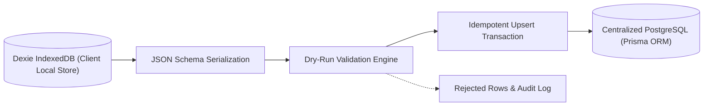

# WATECH-BI — DEXIE TO CENTRALIZED DATABASE MIGRATION SPECIFICATION
**Prompt 06: Phase 6 — Safe Data Migration Strategy**  
**Date:** November 9, 2026  
**Auditor:** Principal Data Integrity Architect & Enterprise Migration Specialist  
**Module:** `src/lib/server/dexieToPostgresMigration.ts`

---

## 1. MIGRATION ARCHITECTURE & STRATEGY

To transition existing local installations and single-user historical research into the authoritative centralized PostgreSQL database without data loss, a non-destructive migration engine has been deployed.

### Core Design Rules
1. **Zero Destructive Actions:** Existing Dexie IndexedDB databases are never wiped or cleared during migration. Dexie remains intact as a local offline mirror and cache.
2. **Preservation of IDs & Relationships:** Original IDs for `projects`, `businesses`, `audits`, `contacts`, `opportunities`, `leadScores`, `crmActivities`, and `followUpSchedules` are preserved verbatim.
3. **Idempotence & Duplicate Immunity:** All entity writes execute as Prisma `upsert` operations. Re-running the migration 10 times results in 0 duplicate records.
4. **Tenant Scoping Guarantee:** Records without an explicit `tenantId` are attributed to the designated `defaultTenantId` (`tenant-watech-hq`), preventing orphaned un-owned records.
5. **Dry-Run Preflight:** Supports `{ dryRun: true }` validating all rows, foreign keys, and required attributes without committing to PostgreSQL.

---

## 2. MIGRATED ENTITY HIERARCHY & RECONCILIATION

| Entity Type | Source Dexie Store | Target PostgreSQL Model | Foreign Key Resolution | Idempotence Key |
| :--- | :--- | :--- | :--- | :--- |
| **Organizations** | `tenants` | `tenants` (`Tenant`) | Root | `slug` / `id` |
| **Projects** | `projects` | `projects` (`ResearchProject`) | `tenantId` | `id` |
| **Businesses** | `businesses` | `businesses` (`Business`) | `tenantId`, `projectId` | `id` |
| **Audits** | `audits` | `website_audits` (`WebsiteAudit`) | `tenantId`, `businessId`, `projectId` | `id` |
| **Findings** | `auditFindings` | `audit_findings` (`AuditFinding`) | `tenantId`, `auditId` | `id` |
| **Contacts** | `contacts` | `contacts` (`Contact`) | `tenantId`, `businessId`, `projectId` | `id` |
| **Opportunities** | `opportunities` | `opportunities` (`Opportunity`) | `tenantId`, `businessId`, `projectId` | `id` |
| **Lead Scores** | `leadScores` | `lead_scores` (`LeadScore`) | `tenantId`, `businessId`, `projectId` | `id` |
| **CRM Activities** | `crmActivities` | `crm_activities` (`CrmActivity`) | `tenantId`, `businessId`, `projectId` | `id` |
| **Follow-up Schedules** | `followUpSchedules`| `follow_up_schedules` | `tenantId`, `businessId`, `projectId` | `id` |

---

## 3. ERROR HANDLING & RECOVERY WORKFLOW

If any row fails validation:
1. It is cataloged in `summary.rejectedRows` with the exact entity name, ID, and reason.
2. Migration continues without aborting valid sibling rows.
3. The migration summary output is returned with total processed, imported count per model, and error details.
