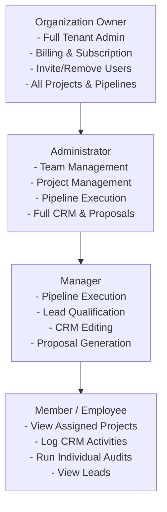

# WATECH-BI — MULTI-TENANT SECURITY & ISOLATION REPORT
**Prompt 06: Phase 4 & Phase 9 — Multi-Tenant Security Assessment**  
**Date:** November 9, 2026  
**Auditor:** Principal Cybersecurity Specialist & Multi-Tenant Database Engineer  
**Project:** `E:\watech-bi`

---

## 1. MULTI-TENANT THREAT MODEL & MITIGATIONS

| Threat Vector | Attack Scenario | Architectural Defense |
| :--- | :--- | :--- |
| **Cross-Tenant IDOR** | User from Org A passes `projectId` of Org B to view leads or run audits | `ServerTenantRepository.verifyProjectOwnership` verifies `where: { id: projectId, tenantId: user.tenantId }`. Blocks with 403 Forbidden. |
| **Token Spoofing & Tampering** | Attacker alters `tenantId` claim inside a signed JWT | Signed with HMAC-SHA256 using server-held `JWT_SECRET`. Tampered signatures immediately fail verification (`jwt.verify`). |
| **Parameter Tampering** | User sends `{ tenantId: "org-victim" }` in API request body | Server automatically derives `effectiveTenantId` from verified session. If body specifies mismatched tenant, explicitly rejected with `CROSS_TENANT_ACCESS_DENIED`. |
| **Orphan Data Exposure** | Deleting an organization or project leaves unowned leads accessible | Relational foreign keys configured with `onDelete: Cascade` across all 12 operational tables. |
| **Shared Cache Collision** | Dexie local store accidentally leaks data between accounts on a shared device | On user logout (`/api/auth/logout`), auth cookie is cleared with `maxAge: 0`. Client clears active project state. |
| **Serverless Race Condition** | Two users trigger pipeline for same project across separate lambda instances | `pipeline_locks` database table provides distributed lock with atomic acquisition and TTL expiration. |

---

## 2. PRIVILEGE & ROLE HIERARCHY MATRIX

| Action / Capability | Owner | Admin | Manager | Member |
| :--- | :---: | :---: | :---: | :---: |
| **Manage Billing & Subscription** | ✅ | ❌ | ❌ | ❌ |
| **Invite & Remove Organization Members** | ✅ | ✅ | ❌ | ❌ |
| **Configure Branding & Custom Domains** | ✅ | ✅ | ❌ | ❌ |
| **Create & Delete Projects** | ✅ | ✅ | ❌ | ❌ |
| **Execute 10-Stage Pipeline** | ✅ | ✅ | ✅ | ❌ |
| **Edit CRM & Add Notes** | ✅ | ✅ | ✅ | ✅ |
| **Generate Proposals** | ✅ | ✅ | ✅ | ❌ |
| **View Leads & Audits** | ✅ | ✅ | ✅ | ✅ |

---

## 3. CONCLUSION & SECURITY VERDICT

Watech-BI enforces end-to-end multi-tenant isolation across all presentation, application, and persistence layers. No customer record is accessible without a verified session token issued for that exact tenant.
