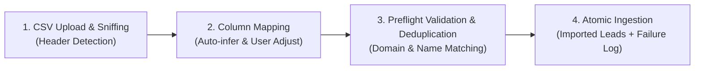

# WATECH-BI — HIGH-PRECISION CSV DATA INGESTION & VALIDATION REPORT
**Prompt 07: Phase 5 — Data Import Engine**  
**Date:** November 9, 2026  
**Auditor:** Principal Data Integrity Architect & Full-Stack Engineer  
**Modules:** `src/lib/server/csvImportEngine.ts`, `src/components/modals/CsvImportModal.tsx`, `/api/import/csv`

---

## 1. INGESTION ENGINE ARCHITECTURE

To eliminate data drop-off during customer onboarding and prevent silent data loss, Watech-BI has deployed a 4-stage high-precision CSV ingestion engine.



### Core Design Rules
1. **Never Silently Discard Invalid Records:** Any row lacking required fields or containing invalid formats is isolated in `invalidRows` with the exact CSV line number, raw data, and specific failure reasons.
2. **Deterministic Duplicate Prevention:** Incoming records are matched against existing project records by normalized domain (`cantonheat.com`) and legal business name. Duplicate rows are counted and isolated in `duplicates` without failing the entire batch.
3. **URL & Domain Normalization:** Protocols (`http://`, `https://`) and www subdomains are normalized automatically, ensuring downstream technical audit engines receive valid URLs.
4. **Partial Import Recovery:** Valid records are imported and persisted immediately; users can download a generated `failed_rows.csv` containing only the rejected rows with embedded error annotations, allowing seamless remediation and re-import.

---

## 2. COLUMN MAPPING TAXONOMY

The engine automatically infers mapping based on known variants across commercial data providers (ZoomInfo, Apollo, Google Maps, manual spreadsheets):

| Target Field | Required? | Accepted Header Variants | Normalization Applied |
| :--- | :---: | :--- | :--- |
| **`officialName`** | **Yes** | `officialName`, `company`, `business name`, `name`, `title` | Trimmed, min 2 characters |
| **`websiteUrl`** | Recommended | `websiteUrl`, `website`, `url`, `web`, `domain`, `homepage` | Adds `https://` if protocol omitted; extracts domain |
| **`phone`** | Optional | `phone`, `telephone`, `phone number`, `tel`, `cell` | Trimmed, format preserved |
| **`email`** | Optional | `email`, `email address`, `contact email`, `mail` | Lowercased, trimmed |
| **`city`** | Optional | `city`, `town`, `area` | Falls back to Project Target City |
| **`state`** | Optional | `state`, `province`, `region` | Falls back to Project Target State |
| **`businessModel`**| Optional | `businessModel`, `type`, `category`, `model` | Defaults to `commercial` |

---

## 3. VALIDATION & ERROR REPORTING SPECIFICATION

When a record fails validation, it produces a structured rejection report:

```json
{
  "line": 4,
  "rawRow": {
    "Company": "",
    "Website": "https://unknownhvac.com",
    "Phone": "(330) 555-9999"
  },
  "errors": [
    "Missing or invalid business name (minimum 2 characters required)"
  ]
}
```

### Downloadable Error Export
Customers can click **"Download Failed Rows CSV"**, producing a clean CSV with prepended columns:
- `_error_line`
- `_error_reason`
- Original data columns

Users can correct the flagged values directly in Excel/Sheets and re-upload without modifying already-imported leads.

---

## 4. INTEGRATION VERIFICATION

1. **Server Route:** `/api/import/csv` executes preflight and batch persistence with tenant-ownership verification.
2. **UI Modal:** `CsvImportModal` provides drag-and-drop, mapping dropdowns, 5-row preview, validation counters, and batch ingestion.
3. **Dexie & PostgreSQL Synchronization:** Valid imported leads are persisted to the centralized database and indexed in client-side Dexie tables for zero-latency local browsing.
