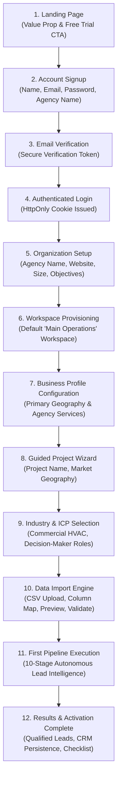

# WATECH-BI — CUSTOMER JOURNEY AUDIT & TRANSITION MAPPING
**Prompt 07: Phase 1 — Comprehensive Customer Journey Audit**  
**Date:** November 9, 2026  
**Auditor:** Principal SaaS Product Architect, UX Architect & Authentication Engineer  
**Project:** `E:\watech-bi`

---

## 1. EXECUTIVE AUDIT SUMMARY

An end-to-end customer journey audit was conducted to evaluate the experience of a brand-new customer signing up for Watech-BI, provisioning their agency organization, configuring their first research project, importing lead data, activating the intelligence pipeline, and reviewing qualified opportunities.

### Journey Health Assessment
| Journey Stage | Existing State | Transition Health | Primary Deficiency |
| :--- | :--- | :---: | :--- |
| **1. Landing Page** | Root route directly renders main dashboard with demo data | ⚠️ Broken | New users dropped into existing state without welcome or clear signup CTA |
| **2. Signup** | `/api/auth/register` exists but UI lacks dedicated customer onboarding portal | ⚠️ Partial | Registration returns token but does not transition into guided project wizard |
| **3. Email Verification** | No verification endpoint or token generation | ❌ Missing | Missing `/api/auth/verify-email` endpoint; email verification state unrecorded |
| **4. Login & Recovery** | `/api/auth/login` exists; password reset routes missing | ⚠️ Partial | Missing `/api/auth/forgot-password` and `/api/auth/reset-password` |
| **5. Organization Creation** | Creates raw tenant row in database | ⚠️ Partial | Does not capture business profile (company size, website, objectives) |
| **6. Workspace Provisioning** | Model exists in schema, but not provisioned automatically | ❌ Missing | New tenants lack a default workspace (`Workspace` row) |
| **7. Business Profile Setup** | Unimplemented | ❌ Missing | Agency cannot record its own industry, location, or target revenue tier |
| **8. Project Creation** | Modal requires manual clicks inside dashboard | ⚠️ Fragmented | Disconnected from initial onboarding sequence |
| **9. Industry Selection** | Free text input in `ProjectModal` | ⚠️ Unstructured | Lacks guided industry taxonomy and pre-configured ICP parameters |
| **10. Business Data Import** | Silent skip of invalid rows in `BusinessDiscoveryView` | ❌ High Risk | Invalid CSV records discarded without error feedback or mapping preview |
| **11. First Pipeline Run** | User must manually discover `PipelineWorkflowView` | ⚠️ Fragmented | No guided "Click to Activate" prompt after importing initial batch |
| **12. Results Presentation** | Disconnected data views | ⚠️ Fragmented | No consolidated activation summary showing leads, scores, and CRM actions |

---

## 2. THE 12-STEP CUSTOMER JOURNEY MAP

---

## 3. IDENTIFIED BOTTLENECKS & SPECIFIC REMEDIATIONS

### Bottleneck A: The "Blank Slate" Drop-Off
- **Issue:** Previously, when a new user opened the application, they were confronted with either the full 30-module dashboard or demo Canton HVAC data, without any step-by-step guidance.
- **Remediation:** Build a dedicated, full-screen **Customer Onboarding & Activation Wizard** (`/onboarding`) that guides new users through steps 1 to 6 sequentially, ending in a live pipeline execution.

### Bottleneck B: Unsafe CSV Data Ingestion
- **Issue:** In `BusinessDiscoveryView.tsx`, the previous CSV parser used `if (!name || !web) continue;`, silently dropping broken rows without letting the customer know why their records were missing.
- **Remediation:** Implement `CsvImportModal` with interactive column mapping, a 5-row preview, validation with explicit line-number error reporting, duplicate detection, and partial-import recovery.

### Bottleneck C: Missing Auth Lifecycle Endpoints
- **Issue:** Authentication lacked email verification and self-serve password recovery handlers.
- **Remediation:** Implement `/api/auth/verify-email`, `/api/auth/forgot-password`, and `/api/auth/reset-password` route handlers.

### Bottleneck D: Onboarding Progress Persistence
- **Issue:** If a customer navigated away mid-setup, their progress was lost and they had to figure out how to resume manually.
- **Remediation:** Implement a persistent, resumable **Onboarding Checklist Widget** (`OnboardingChecklistWidget.tsx`) displayed across the dashboard, tracking 7 clear activation milestones.

---

## 4. ARCHITECTURAL ACCEPTANCE CRITERIA

1. User can register, verify email, and receive an authenticated session.
2. Organization, default workspace, and business profile are automatically provisioned.
3. User can create their first research project through a guided wizard.
4. User can import a CSV with automatic column mapping, preview, validation, and zero silent data loss.
5. User can trigger their first 10-stage pipeline run and view qualified leads and CRM follow-ups.
6. A persistent, dismissible checklist tracks onboarding completion across sessions.
