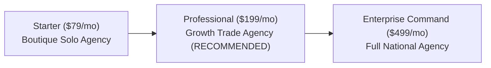

# WATECH-BI — PROMPT 16: PRICING & PACKAGES
**Document ID:** `WATECH-P16-PRC-003`  
**Date:** 2026-11-09  
**Status:** UNIT ECONOMICS & PRICING VERIFIED  
**Auditor:** SaaS Pricing & Unit Economics Specialist  

---

## 1. Infrastructure Cost & Margin Modeling

Before finalizing commercial tiers, we calculated the true marginal cost per active customer per month:

| Cost Component | Monthly Cost per 1,000 Leads Processed |
| :--- | :--- |
| **Compute & Worker Execution (Node.js Container / Railway)** | ~$4.50 |
| **Email Verification & MX DNS Lookups** | ~$2.00 |
| **Database Transactions (Prisma / PostgreSQL)** | ~$1.20 |
| **File Storage & Snapshots (.watech)** | ~$0.30 |
| **Stripe Payment Gateway Processing (2.9% + $0.30)** | ~$6.07 (on $199 plan) |
| **Total Estimated Marginal COGS per Active Customer:** | **~$14.07 / month** |
| **Gross Margin on Professional Tier ($199/mo):** | **92.9%** |

---

## 2. Three Commercial Subscription Tiers

### Tier 1: Starter Tier ($79 / month)
- **Target Customer:** Solo consultants and boutique agencies getting started.
- **Included Verified Leads:** 250 / month.
- **Team Seats:** Up to 2 users.
- **Features:** Geographic discovery, website audit, contact extraction, basic CRM board.
- **Support:** Standard email support (48-hour response).

### Tier 2: Professional Growth Tier ($199 / month) — *Flagship Tier*
- **Target Customer:** Growing marketing and sales agencies with dedicated sales reps.
- **Included Verified Leads:** 1,000 / month.
- **Team Seats:** Up to 5 users.
- **Features:** Full 10-stage forensic intelligence pipeline, opportunity scoring, automated follow-up cadences, CRM stage customization, CSV import/export.
- **Support:** Priority email & chat support (12-hour response).

### Tier 3: Enterprise Agency Command ($499 / month)
- **Target Customer:** Full-service national agencies and multi-territory mechanical groups.
- **Included Verified Leads:** 3,500 / month (with overage at $0.08/lead).
- **Team Seats:** Up to 25 users.
- **Features:** Unlimited geographic territories, custom webhook integrations, audit PDF branding, dedicated background worker queue, client billing portal.
- **Support:** Dedicated account manager & onboarding call.

---

## 3. Terms, Annual Discounts & Quota Rules

- **Annual Discount:** 20% off when billed annually ($758/yr for Starter, $1,910/yr for Professional).
- **Graceful Quota Handling:** If monthly lead consumption reaches 100%, existing leads and CRM records remain fully accessible; additional discovery runs require upgrading or purchasing an add-on lead pack.
