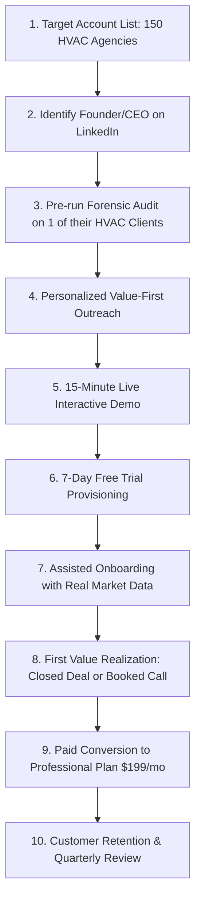

# WATECH-BI — PROMPT 16: CUSTOMER ACQUISITION PLAN
**Document ID:** `WATECH-P16-ACQ-004`  
**Date:** 2026-11-09  
**Goal:** Acquire First 10 Paying SaaS Customers in 45 Days  
**Auditor:** Lead Growth Strategist & Sales Operations Lead  

---

## 1. The 10-Step Customer Acquisition Funnel

---

## 2. Practical Weekly Sales Cadence & Conversion Targets

| Funnel Stage | Conversion Rate Target | Weekly Volume Target (Weeks 1–4) | Cumulative 4-Week Target |
| :--- | :--- | :--- | :--- |
| **Target Prospects Identified** | 100% | 40 agency founders | 160 accounts |
| **Personalized Audits Sent** | 80% | 32 audits | 128 audits |
| **Positive Responses** | 15% | ~5 responses | 20 responses |
| **Live Demos Booked** | 70% of responses | ~3-4 demos | 15 demos |
| **Trials Activated** | 80% of demos | ~3 trials | 12 trials |
| **Paid Conversions** | 75% of trials | ~2-3 conversions | **10 Paying Customers** |

---

## 3. High-Converting Value-First Outreach Template

> **Subject:** Quick question about {{Agency_Name}}'s HVAC client acquisition in Ohio
>
> Hi {{First_Name}},
>
> Noticed {{Agency_Name}} specializes in marketing for trade and mechanical contractors.
>
> We ran our automated technical pipeline against 15 HVAC contractors in the Canton/Akron area and identified 6 commercial contractors with critical mobile speed drops and missing local schema, along with direct General Manager contacts.
>
> Here’s a 1-page sample dossier we generated: {{Link_to_Sample_Dossier}}
>
> Would you be open to a 10-minute walkthrough this Thursday at 2 PM to see how your agency can use these automated audits to close new HVAC retainers?
>
> Best regards,  
> **Watech Intelligence Team**

---

## 4. Key Objections & Battle-Tested Counters

1. *"We already use Apollo/ZoomInfo."*  
   **Response:** "ZoomInfo gives you static contact numbers, but it doesn't run a 10-stage technical audit on the contractor's website to give you the exact technical leverage to close them on the spot. WATECH-BI bridges intelligence directly into the pitch."
2. *"Is this another AI email spammer?"*  
   **Response:** "No. WATECH-BI is a vertical intelligence and CRM platform that gives you verified decision-makers and genuine diagnostic data for consultative sales."
