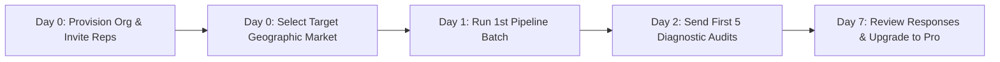

# WATECH-BI — PROMPT 16: CUSTOMER ONBOARDING GUIDE
**Document ID:** `WATECH-P16-ONB-007`  
**Date:** 2026-11-09  
**Auditor:** Head of Customer Success & Retention  

---

## 1. The 48-Hour "First Value Realization" Framework

The goal of customer onboarding is to guide the user to their first "Aha!" moment within **15 minutes** of signing up, and their first completed prospect pitch within **48 hours**.

---

## 2. Onboarding Milestones & White-Glove Support Checklist

1. **Step 1: Workspace Initialization (5 Minutes):**
   - User registers account at `/onboarding`.
   - Name organization and upload agency branding/logo.
   - Invite sales development representatives (SDRs) and account executives.
2. **Step 2: Territory Selection (5 Minutes):**
   - Define primary geographic market (State, City, Radius).
   - Filter by trade category: HVAC (Residential, Commercial, Industrial).
3. **Step 3: Initial Lead Batch Processing (10 Minutes):**
   - Import target CSV or execute geographic discovery query.
   - Execute 10-stage intelligence pipeline.
   - Review opportunity scores and qualified lead dossiers.
4. **Step 4: CRM Pipeline Configuration (15 Minutes):**
   - Customize CRM stages: `New Lead` → `Audit Delivered` → `Discovery Call` → `Proposal` → `Retainer Signed`.
   - Connect email integration or review scheduled follow-up cadences.

---

## 3. Dedicated Customer Success Cadence

- **Day 1 Check-in:** Review initial discovery batch and confirm email deliverability.
- **Day 4 Strategy Call (15 Mins):** Review prospect responses, objection handling, and pitch formatting.
- **Day 7 Activation Review:** Formalize subscription tier upgrade and team quota allocation.
